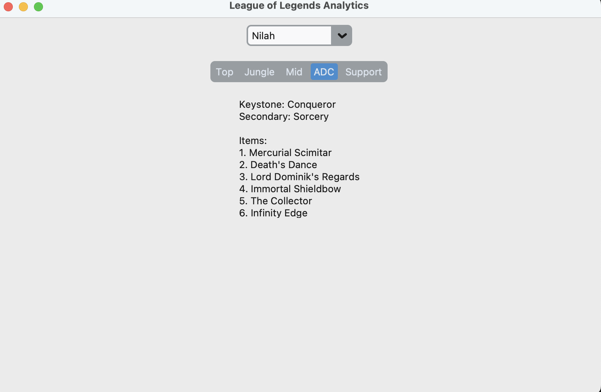

# League of Legends Analytics

League of Legends Analytics is a desktop app that recommends item builds and runes for your champion and lane, based on statistics from high-elo ranked games.

**Status: V1 complete.** Pick a champion and a lane, and the app shows the most successful keystone, secondary rune tree, and item build for that pick.

## Project Goal

The goal is to help players make more informed decisions during champion selection. The application will use champion, item, rune, and match data to generate recommendations suited to the selected matchup and team compositions.

## MVP Scope

The first usable version will focus on:

- Allowing users to enter their champion and both teams’ champion selections.
- Retrieving the game data needed to support recommendations.
- Processing relevant statistics to recommend item builds and rune setups.
- Displaying the recommendations in a simple interface.

The MVP will use manual champion input. Automatic champion detection is outside the initial scope.

## Screenshot



## How to Run

### Requirements

- Python 3.12
- An internet connection (champion, item, and rune names are loaded from Data Dragon at startup)

### Setup

```bash
git clone https://github.com/Dyperis/League-of-Legend-Analytics.git
cd League-of-Legend-Analytics
python3 -m venv .venv
source .venv/bin/activate        # Windows: .venv\Scripts\activate
pip install -r requirements.txt
```

### Launch the app

```bash
python src/main.py
```

The recommendation data (`data/builds.json` and `data/runes.json`) is already included, so the app runs without a Riot API key.

### Rebuilding the data (optional)

You only need this to collect fresh matches, for example on a new patch.

1. Copy `.env.example` to `.env` and add your Riot API key:

   ```
   RIOT_API_KEY=your_riot_api_key_here
   ```

   `.env` is listed in `.gitignore`, so your key stays out of the repository. Development keys expire every 24 hours.

2. From the `src/` folder, collect matches and then recompute the statistics:

   ```bash
   cd src
   python -m collector.collect      # downloads matches into data/raw/ (slow: rate-limited, can take ~17 hours)
   python -m analysis.buildStats    # writes data/builds.json
   python -m analysis.runeStats     # writes data/runes.json
   ```

   The patch window is set by `START_TIME` and `END_TIME` in `src/collector/collect.py`.

## Future Plans

After completing the MVP, planned features include:

- **Team composition suggestions:** Help users identify strengths, weaknesses, and gaps in their team’s composition.
- **Champion suggestions based on playstyle:** Recommend champions that fit a player’s preferred role and style of play.

Flash timers and other summoner spell trackers are outside the project’s planned scope.

## Tech Stack

- **Python:** Main programming language.
- **Riot Games Data Dragon:** JSON files providing champion, item, and rune information.
- **Riot Games API:** Retrieve match histories and individual match statistics for analysis.
- **RiotWatcher:** Python wrapper for Riot’s API, with built-in rate-limit handling.
- **lcu-driver:** Communicate with the local League Client API to read champion selection information.
- **SQLite:** Store collected match data and calculated statistics.
- **pandas and NumPy:** Process match data, calculate win rates, and support item and rune recommendations.
- **CustomTkinter:** Build the desktop interface for entering information and displaying recommendations.
- **Git and GitHub:** Track development progress and host the project.

## Design Documents

The `docs/` folder will contain:

- The Eisenhower Matrix defining project priorities.
- The System Diagram showing the program’s workflow.

## Development Status

**V1 is complete.** Data retrieval, data processing, recommendation logic, and the CustomTkinter interface are all implemented. V1 recommends builds by champion and lane; recommendations based on both teams' compositions are the next step.
